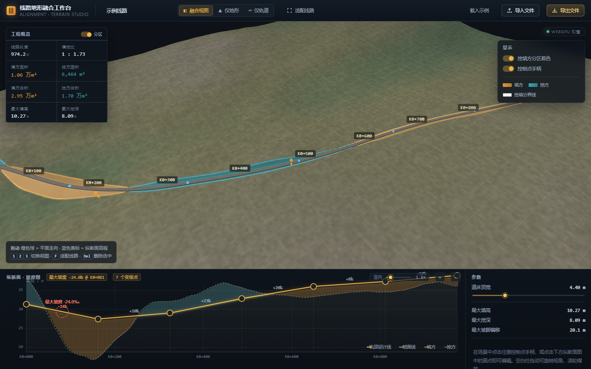
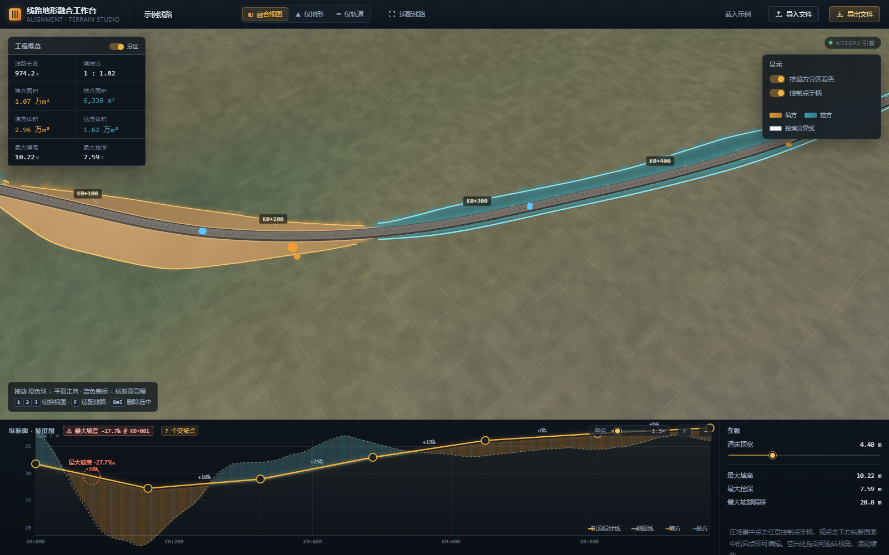
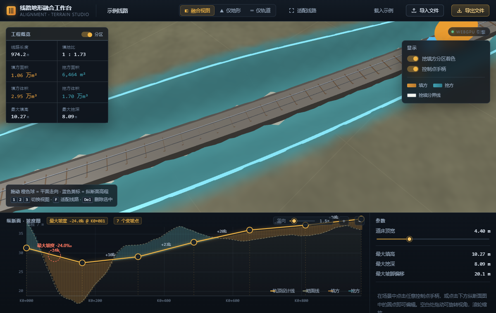

# 线路地形融合工作台

基于 **TypeScript + Vue 3 + Babylon.js（WebGPU 引擎）** 的浏览器端线路 / 地形三维融合工具。
在起伏地形上拖动线路控制点即可实时改变走向与坡度，轨道几何、填挖方与纵断面曲线同步重建；
项目数据保存在浏览器本地，可通过导出 / 导入 JSON 文件分享与还原。



<div align="center">
  
  
  <div><sub>左：填方区（橙色分区 + 金色坡脚线）　右：挖方区（青色分区 + 青色坡脚线）</sub></div>
</div>

## 功能

| 能力 | 说明 |
| --- | --- |
| 三维地形 | 程序化生成的起伏地形（约 31 万顶点，2 m 网格），含高程分层配色、20 m 工程网格、四周裙边；支持导入任意尺寸地形 |
| 平面走向 | 控制点 + 圆曲线半径，自动计算切线并限制曲线半径（相邻边长不足时自动压缩） |
| 纵断面 | 变坡点控制轨顶高程，实时生成坡段；标出**坡度变化点**与**最大坡度**（‰），超过设计限坡时高亮告警 |
| 轨道几何 | 道床（顶宽可调，1:1.5 边坡）、轨枕 ＋ 双线钢轨、黄色中心线，全部沿实时重建的中心线放样 |
| 贴合地形 | 挖方区直接在地形网格上开挖成堑口；填方区以路堤边坡落到地面，坡脚精确搜索并沿线平滑 |
| 挖填方分区 | 填方橙、挖方青，按每顶点解析覆盖度着色（边界连续无锯齿），坡面贴地描边带标示**挖填分界线**，可一键关闭 |
| 纵断面曲线 | 底部 Canvas 图表：地面线（虚线）、轨顶设计线、填挖色带、每段坡度、变坡点、竖向放大 1×–6× |
| 里程标 | 沿线每 100 m 一座里程桩与悬浮里程牌 |
| 视图切换 | 融合视图 / 仅地形 / 仅轨道 三态切换（快捷键 1 / 2 / 3） |
| 导出 / 导入 | 单文件 JSON（地形高程 ＋ 平面 / 纵断面控制点 ＋ 设置），导入后轨道与挖填方自动重算 |

## 快速开始

```bash
npm install
npm run dev      # http://127.0.0.1:5173
npm run build    # 类型检查 + 生产构建到 dist/
npm run preview  # 预览构建产物
```

**浏览器要求：** 需要支持 WebGPU 的浏览器（Chrome / Edge 113+，Safari 26+，Firefox 141+），
并使用 `https` 或 `localhost` 访问（WebGPU 仅在安全上下文可用）。
若无法获取 WebGPU 适配器，界面会给出明确提示而不是空白页面。

## 操作

| 操作 | 效果 |
| --- | --- |
| 拖动橙色球 | 移动平面控制点，线路走向随之改变 |
| 拖动蓝色菱标 | 调整纵断面变坡点的高程 / 里程 |
| 点击纵断面图圆点 | 选中变坡点，可拖动 |
| 左键拖动空白 | 旋转视角；滚轮缩放；右键平移 |
| `F` | 视角适配到线路范围 |
| `1` / `2` / `3` | 融合 / 仅地形 / 仅轨道 |
| `Del` / `Backspace` | 删除选中的控制点 |
| 右侧参数面板 | 道床顶宽滑块；选中控制点后可直接输入坐标 / 高程 |

## 数据与文件格式

项目数据保存于 `localStorage`（每 0.9 s 自动保存），并可通过顶栏 **导出文件** 下载：

```jsonc
{
  "format": "rail-terrain-studio",
  "version": 1,
  "name": "示例线路",
  "settings": { "ballastWidth": 4.4, "maxGradePermille": 25 },
  "terrain": {
    "nx": 641, "nz": 481, "cell": 2,
    "originX": -640, "originZ": -480,
    "heightsMm": [ /* 千分位整数的米制高程，保证 1 mm 精度 */ ]
  },
  "plan":    [{ "id": "P1", "x": -430, "z": 300, "radius": 0 }, ...],
  "profile": [{ "id": "vp1", "s": 0, "y": 31.8 }, ...]
}
```

导入时校验格式版本、网格尺寸与高度数量，控制点数量不足会给出具体错误。
导入只还原**地形高度 ＋ 控制点**，轨道、边坡、挖填方分区与纵断面全部由几何内核重新计算。

## 实现要点

```
src/
├─ core/                 纯 TypeScript 几何内核（无 Babylon 依赖，可单独测试）
│  ├─ terrain.ts         地形生成 / 双线性采样 / 法向
│  ├─ alignment.ts       平面圆曲线、纵断面插值、限坡拟合、控制点约束
│  ├─ corridor.ts        逐桩断面：坡脚搜索、填挖模式判定、方量积分
│  ├─ raster.ts          2 m 走廊栅格（填挖分区、色带）
│  ├─ grading.ts         地形开挖、路堤边坡网格、分界描边带
│  └─ project.ts         序列化 / 校验 / 本地草稿
├─ babylon/              渲染层
│  ├─ studio.ts          引擎、相机、控制点手柄、拖动交互
│  ├─ sceneBuild.ts      地形网格、挖填着色、里程标、裙边
│  ├─ track.ts           道床 / 轨枕 / 钢轨 / 中心线放样
│  └─ *Shader.ts         自定义 WGSL（地形、通用受光材质）
└─ chart/profileChart.ts 纵断面 Canvas 图表（含拖动编辑）
```

- **圆曲线**：切线长 `T = R·tan(θ/2)`；当 `T` 超过相邻边长的 45% 时按几何上限压缩半径，
  界面同时显示设计半径与实际半径。
- **坡脚求解**：沿法向以 0.5 m 步长求边坡面与地面的交点，线性插值定位；随后对两侧坡脚做
  加权滑动平均，消除逐桩采样造成的锯齿。
- **开挖与填筑**：挖方断面把地形顶点压至设计断面（含 1:1.15 边坡），形成真实堑口；
  填方断面保留原地形并叠加 1:1.5 路堤边坡。挖填分界线由独立的贴地描边网格绘制。
- **限坡拟合**：对平滑后的地面纵断面做正反双向坡度限制迭代，再按中位高差整体平移，
  得到坡度合规、填挖大致平衡的设计线。
- **性能**（本机 31 万顶点地形实测）：拖动过程中只重建轨道与路基网格（约 20–35 ms/次），
  不触碰地形网格，拖动手感仍然连续；松手后一次性结算地形开挖、顶点法与顶点色（约 0.15–0.2 s），
  且只上传走廊影响范围内的顶点与索引。

## 已知限制

- 依赖 WebGPU；在仅有 WebGL2 的环境下无法运行。
- 地形为程序化生成的演示地形，不含真实 DEM 数据导入。
- 方量按梯形断面积分估算，未考虑清表、压实系数等施工细部。
